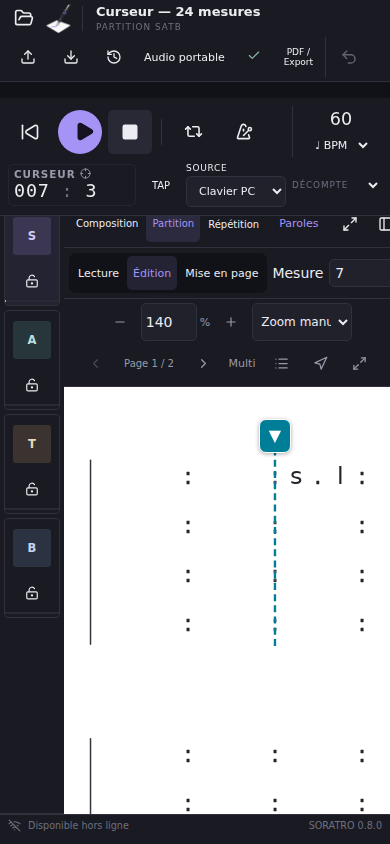
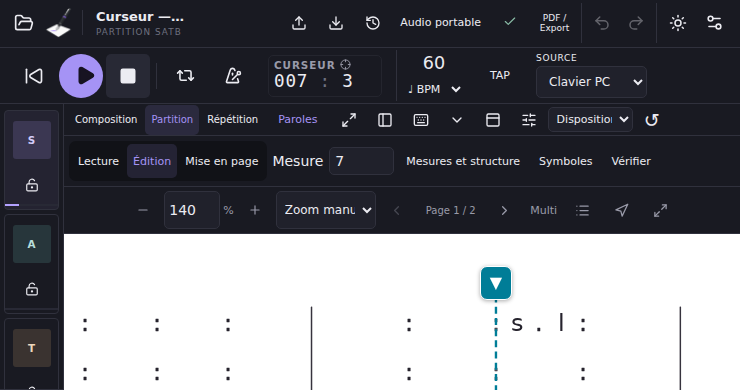
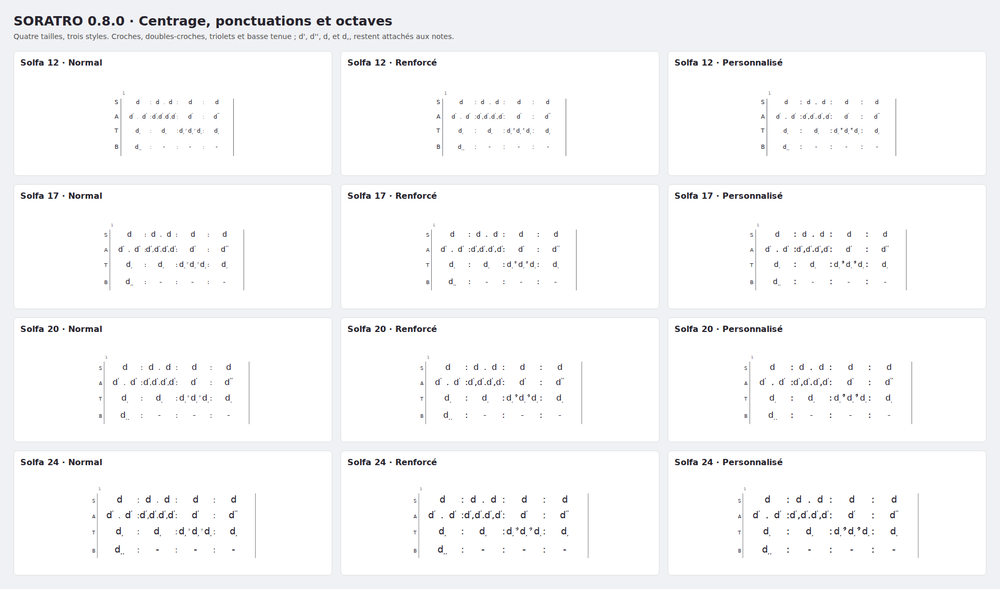
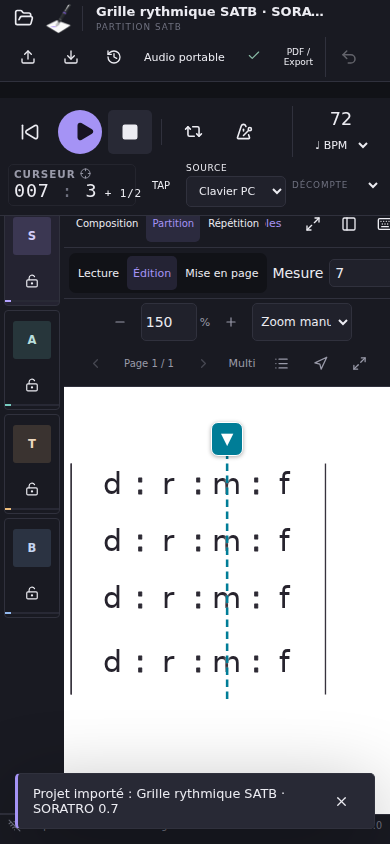

# Qualification Web — SORATRO 0.8.0

Cette évolution centre les symboles Solfa dans leurs cellules musicales et ajoute un curseur de travail commun à Partition, Piano Roll, mini-timeline et transport. Elle prolonge la version 0.7.0 du dépôt `ZoNampoina/soratro`, commit `1c5a8b389b6e1f71d29a110c474947ff75746fda`, sans recréer l'application.

## Résultat fonctionnel

Le centre visuel dépend du début et de la fin de la cellule de chaque voix. Les contours complets de la lettre, de l'altération et des octaves sont centrés ensemble. Les ponctuations restent sur leurs frontières rythmiques. Leurs styles, les tailles Solfa, les colonnes communes SATB et les lignes incomplètes sont conservés. La gravure ne modifie aucun événement MIDI, aucune durée ni aucun timing.

Le curseur de travail est distinct de la sélection et de la tête audio. Aller à… rejoint aussi horizontalement sa position exacte à fort zoom ; le suivi audio défile lorsque la tête approche du bord. Clic, toucher, appui prolongé, poignée, numéros de mesure, **Aller à…** et raccourcis Alt le déplacent sans effacer les notes sélectionnées. Play démarre au curseur ; Pause reprend le passage audio courant ; Stop conserve la position de travail. L'insertion et le collage utilisent cette position et leur durée musicale active.

Un départ au milieu initialise le parcours au premier passage de la mesure choisie. Les sections antérieures ne sont pas jouées initialement ; les reprises et renvois rencontrés ensuite restent actifs et peuvent revenir en arrière. Cette règle est affichée dans Aller à… et détaillée dans le [guide](WEB-CURSOR-V0.8.md). Le métronome conserve sa phase, y compris à mi-temps ; une note déjà tenue est reprise une seule fois.

Les anciens projets gardent leur schéma musical et leur format portable. Le curseur est une préférence locale par projet, conservée entre vues et après rechargement. Les protections de REC, décompte, pré-roll et voix verrouillées restent actives. Les fonctions antérieures d'édition, paroles, présentation, capture vocale, Punch, Loop Recording, prises et sauvegarde audio portable restent couvertes par la suite complète.

## Validation technique locale

| Vérification | Résultat |
| --- | --- |
| Compilation TypeScript et build GitHub Pages | Réussis |
| Tests unitaires | **177 réussis**, aucun échec |
| Tests d'interface | **4 réussis**, aucun échec |
| Parcours Chromium complets | **73 réussis**, aucun échec, environ 3 minutes |
| Variantes de gravure | 12 : tailles 12, 17, 20, 24 × Normal, Renforcé, Personnalisé |
| Mise à jour PWA réelle 0.7 → 0.8 | Projet, 96 notes, marqueur et zoom conservés |
| Arrêt du processus navigateur puis démarrage hors ligne | Réussi ; curseur 4,25 restauré, PDF hors ligne produit |

Les [résultats structurés](validation-v0.8/local-result.json), [journaux unitaires et UI](validation-v0.8/unit-ui.log), [journal Chromium](validation-v0.8/chromium.log), [build](validation-v0.8/build.log) et [preuve PWA](validation-v0.8/pwa-result.json) sont conservés avec les sources.

| Cas demandé | Vérification effectuée |
| --- | --- |
| A — Une note par temps | Centre 1/2 de chaque temps ; attaque musicale inchangée |
| B — Deux demi-temps | Centres 1/4 et 3/4 ; point à 1/2 |
| C — Quatre quarts | Centres 1/8, 3/8, 5/8, 7/8 ; frontières exactes |
| D — Trois tiers | Centres 1/6, 1/2, 5/6 ; subdivisions traditionnelles |
| E — Octaves | Altérations et une ou deux marques hautes/basses attachées et centrées ensemble ; accords aussi |
| F — Mesure 7, temps 3 | Curseur à 26 noires ; démarrage des oscillateurs audio à cette position |
| G — Demi-temps | Curseur à 26,5 ; premier clic suivant 0,5 seconde après la note à 60 BPM |
| H — Vues synchronisées | Partition ↔ Piano Roll, règle, numéros, mini-timeline, raccourcis et rechargement ; sélection conservée |
| I — Insertion | Note MIDI 73 à 25,5, durée 0,25 ; insertion par outil et collage ; Undo/Redo |
| J — Android Web | Toucher et gestes CDP tactiles réels, poignée visible après Aller à… à 140 %, Play/Stop sur cinq dimensions tactiles |
| K — Exports | Aperçu et SVG reprennent les coordonnées de gravure ; 168 positions PDF/SVG, octaves incluses, comparées ; PNG issu du même SVG ; aucun calque de curseur imprimé |

Le scénario de 24 mesures inclut **mesure 12, temps 3, deuxième demi-temps = 46,5 noires**, vérifié dans les deux vues. Les tests ajoutés couvrent aussi les durées irrégulières, silences, prolongations, paroles, signatures composées, levée, changements de signature et tempo, départ après un Fine antérieur, reprises futures, pause dans une reprise et REC clavier depuis le curseur 26,5.

Le centre dans les coordonnées de gravure est vérifié à `10⁻⁷ px`. Le SVG sérialise à trois décimales. La mesure indépendante des contours par Canvas dans Chromium accepte `0,6 px`, pour le hinting de la police ; cette tolérance ne modifie pas les coordonnées musicales.

## Écrans et exports examinés

Huit dimensions sont exercées : **360×640, 390×844, 412×915, 740×390, 800×1280, 1366×768, 1440×900 et 1920×1080**. Les cinq premières utilisent un contexte tactile ; les trois autres la souris. Les captures correspondantes sont dans `validation-v0.8/cursor-*.png`.

L'[export PDF réel du navigateur](validation-v0.8/cursor-centering.pdf), son [rendu inspecté](validation-v0.8/cursor-pdf-render.png), le [PNG réel](validation-v0.8/cursor-centering.png), le [SVG réel compressé](validation-v0.8/cursor-centering.svg.xz) et les [12 paires SVG/PDF](validation-v0.8/centering-12-variants.tar.xz) permettent de revoir les résultats. Les PDF et les contours d'octaves ont été inspectés visuellement après rendu. Un [contrôle indépendant des opérateurs PDF](validation-v0.8/export-coordinates.json), [reproductible](validation-v0.8/verify-export-coordinates.py), compare les 168 positions de texte de la première page avec le SVG réel, octaves comprises : erreur maximale **0,00035 point**, sous le seuil de 0,001 point.

## Performance

Le [benchmark](validation-v0.8/benchmark.json) utilise Node 24.19.0, 100 mesures, quatre voix, 2 400 notes, huit couplets et 1 600 syllabes, sur six gravures successives. Résultat : **25 systèmes, 13 pages, premier calcul 431,3 ms, médiane à chaud 309,9 ms, maximum à chaud 350,6 ms**. Cette mesure concerne le moteur dans cet environnement ; elle n'est pas une mesure de latence sur téléphone.

## Publication et limites

Le site est disponible à **https://zonampoina.github.io/soratro/**. Le commit de qualification de l'application est **`5d736d51b68c3419d6edcc4a87771ae8591a4425`**. La consolidation de ce rapport et de ses preuves ajoute uniquement des fichiers de documentation ; la version servie est contrôlée à nouveau après ce dernier déploiement.

Les workflows [validation Chromium](https://github.com/ZoNampoina/soratro/actions/runs/38117857722) et [publication GitHub Pages](https://github.com/ZoNampoina/soratro/actions/runs/38117857723) sont **terminés avec succès**. Les journaux décodés confirment chacun **177 tests unitaires, 4 tests d'interface et 73 parcours navigateur réussis**. Le job de déploiement est aussi réussi. Le [résultat CI structuré](validation-v0.8/ci-runtime-result.json) et les [journaux Chromium](validation-v0.8/ci-runtime-browser.log) / [Pages](validation-v0.8/ci-runtime-pages-build.log) sont conservés dans le dépôt. L'artefact GitHub `Chromium-validation-5d736d51b68c3419d6edcc4a87771ae8591a4425`, avec traces, captures et exports, est disponible dans le workflow pendant 30 jours, jusqu'au 10 novembre 2026.

Le [contrôle du site public](validation-v0.8/public-result.json) sur **390×844** vérifie la version **0.8.0**, le commit exact, une partition SATB de sept mesures et 116 notes à taille 20, les colonnes 4+3 et les styles de ponctuation. Le centre des contours complets reste sous la tolérance de hinting de 0,6 px ; l'erreur maximale de sérialisation des frontières est **0,00045 px**.

Le même contrôle vérifie **mesure 7, temps 3, deuxième demi-temps = 26,5**, le curseur commun aux deux vues, sa poignée visible à **150 %**, le démarrage audio, Stop, les trois exports sans curseur, le rechargement hors ligne avec restauration à 26,5 et le PDF hors ligne. Il ne relève aucune erreur JavaScript. Les données musicales sont identiques avant et après navigation, zoom, lecture et rechargement.

L'[export PDF du site](validation-v0.8/public-grid.pdf) et le [PDF produit hors ligne](validation-v0.8/public-offline.pdf) sont conservés. La partition de contrôle historique garde son titre « Grille rythmique SATB · SORATRO 0.7 » lors de l'import ; la version de l'application est vérifiée séparément dans `version.json` et dans l'interface.

La qualification tactile repose sur Chromium avec événements tactiles réels et différentes dimensions d'écran. Aucun téléphone Android physique, périphérique MIDI, microphone réel ni imprimante physique n'a été testé. Les tests vocaux utilisent le signal synthétique et les permissions simulées de la suite existante. La publication concerne uniquement le Web ; aucune nouvelle APK ni aucun EXE ne sont produits.
